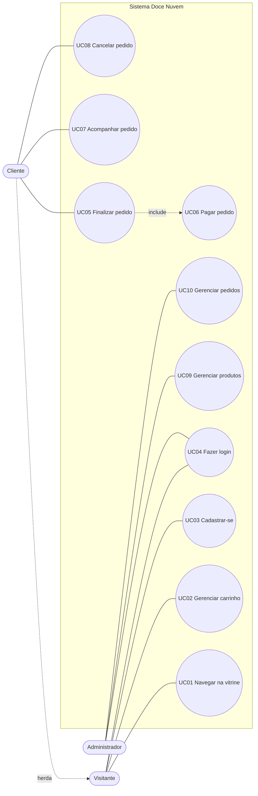

# 2. Casos de uso

## Casos de uso expandidos (principais)

### UC05 – Finalizar pedido
- **Ator:** Cliente
- **Pré-condição:** cliente logado e carrinho com itens.
- **Fluxo principal:**
  1. O cliente abre o carrinho e clica em "Finalizar pedido".
  2. O sistema mostra as opções de entrega, pagamento e o resumo.
  3. O cliente escolhe "Receber em casa" e um endereço salvo ou novo.
  4. O cliente escolhe a forma de pagamento (UC06).
  5. O cliente confirma.
  6. O sistema valida estoque, valor mínimo e endereço, calcula o frete, baixa o estoque, cria o pedido e esvazia o carrinho.
  7. O sistema mostra a página do pedido com o status.
- **Fluxos alternativos:**
  - 3a. Retirada na loja: não pede endereço e o frete é zero.
  - 6a. Subtotal menor que R$ 15: mostra "O pedido mínimo é de R$ 15,00".
  - 6b. Estoque insuficiente: informa a quantidade disponível e não cria o pedido.
  - 6c. Endereço inválido: mostra os campos com erro.
- **Pós-condição:** pedido gravado e estoque atualizado.

### UC06 – Pagar pedido
- **Ator:** Cliente
- **Fluxo principal:**
  1. O cliente escolhe PIX.
  2. O sistema aprova na hora e o pedido fica "Pago".
- **Fluxos alternativos:**
  - 1a. Cartão: o cliente informa número, validade e CVV. O sistema valida o número (algoritmo de Luhn), a validade e o CVV. Se algo estiver errado, mostra a mensagem e não cria o pedido.
  - 1b. Dinheiro: o pedido fica "Aguardando pagamento".

### UC07 – Acompanhar pedido
- **Ator:** Cliente
- **Fluxo principal:**
  1. O cliente abre "Meus pedidos" e escolhe um pedido.
  2. O sistema mostra os itens, os valores e a linha do tempo do status.
- **Exceção:** se o pedido for de outro cliente, o sistema responde "sem permissão" (erro 403).

### UC08 – Cancelar pedido
- **Ator:** Cliente
- **Fluxo principal:**
  1. Na página do pedido, o cliente clica em "Cancelar pedido" e confirma.
  2. O sistema muda o status para "Cancelado" e devolve o estoque.
- **Alternativo:** pedido já em preparo. O botão não aparece e o sistema recusa o cancelamento.

### UC10 – Gerenciar pedidos
- **Ator:** Administrador
- **Fluxo principal:**
  1. O administrador abre o painel e filtra por status.
  2. Clica no botão de avançar ("→ Em preparo", por exemplo).
  3. O sistema muda para o próximo status do fluxo (RN06).
- **Alternativo:** o administrador cancela um pedido que ainda pode ser cancelado (RN05).

### UC09 – Gerenciar produtos
- **Ator:** Administrador
- **Fluxo principal:**
  1. O administrador cadastra ou edita nome, descrição, categoria, preço, estoque e cor, e define se o produto fica ativo.
  2. O sistema valida os dados (preço maior que zero, estoque não negativo) e salva.
