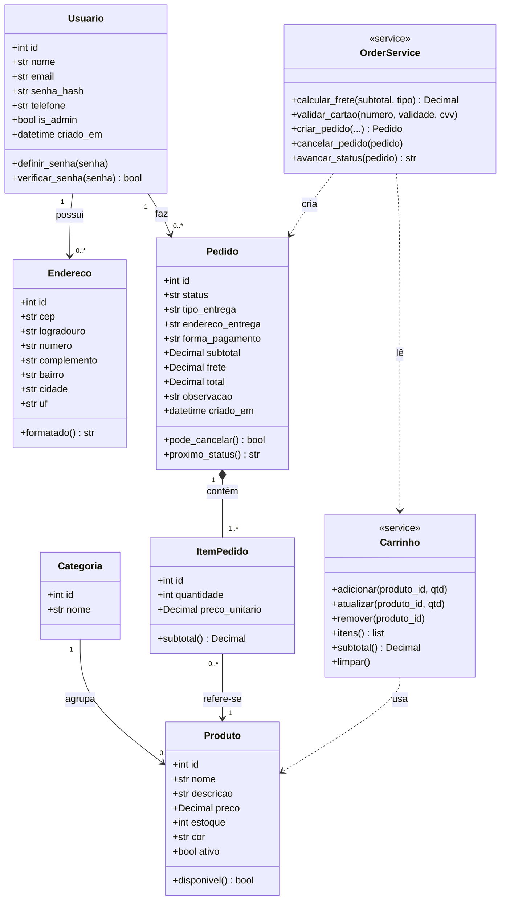

# 3. Diagrama de classes

## Arquitetura MVC
| Camada | Onde fica | Responsabilidade |
|---|---|---|
| Model | `app/models.py` | Entidades e mapeamento para o PostgreSQL (SQLAlchemy). |
| View | `app/templates/` | Páginas HTML (Jinja2), CSS e JavaScript. |
| Controller | `app/controllers/` | Recebe as requisições, chama os serviços e escolhe a view. |
| Serviços | `app/services/` | Regras de negócio (carrinho, frete, pagamento, validações). |
