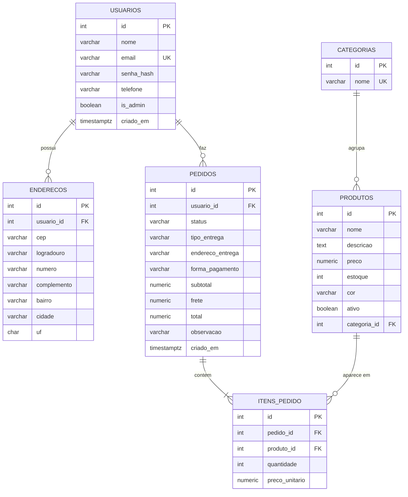

# 4. Banco de dados

SGBD: **PostgreSQL**. O script do projeto físico está em [`schema.sql`](schema.sql).
Na aplicação, as tabelas são criadas automaticamente pelo SQLAlchemy.

## Projeto conceitual / lógico (normalizado até a 3FN)

### Decisões de normalização
- **1FN:** todos os atributos são atômicos. Os itens do pedido ficam numa tabela própria (`itens_pedido`), não numa lista dentro de `pedidos`.
- **2FN:** em `itens_pedido` a chave é `id` e cada atributo depende do item inteiro.
- **3FN:** a categoria fica em tabela própria, e não como texto repetido em cada produto.
- **Desnormalizações intencionais:**
  - `itens_pedido.preco_unitario` guarda o preço do momento da compra. Se o preço do produto mudar depois, o pedido antigo não muda.
  - `pedidos.endereco_entrega` guarda uma cópia do texto do endereço, para manter o histórico mesmo que o cliente apague ou edite o endereço depois.

## Dicionário de dados

### usuarios
| Coluna | Tipo | Nulo | Chave | Descrição |
|---|---|---|---|---|
| id | SERIAL | não | PK | Identificador do usuário |
| nome | VARCHAR(120) | não | | Nome completo |
| email | VARCHAR(160) | não | UK | E-mail de login (único, minúsculas) |
| senha_hash | VARCHAR(256) | não | | Hash da senha (Werkzeug/PBKDF2 ou scrypt) |
| telefone | VARCHAR(20) | sim | | Telefone de contato |
| is_admin | BOOLEAN | não | | Verdadeiro para administradores da loja |
| criado_em | TIMESTAMPTZ | sim | | Data e hora do cadastro |

### categorias
| Coluna | Tipo | Nulo | Chave | Descrição |
|---|---|---|---|---|
| id | SERIAL | não | PK | Identificador |
| nome | VARCHAR(60) | não | UK | Ex.: Clássicos, Gourmet, Veganos, Sem glúten |

### produtos
| Coluna | Tipo | Nulo | Chave | Descrição |
|---|---|---|---|---|
| id | SERIAL | não | PK | Identificador |
| nome | VARCHAR(120) | não | | Nome do cupcake |
| descricao | TEXT | não | | Descrição exibida na vitrine |
| preco | NUMERIC(10,2) | não | | Preço unitário em R$ (CHECK > 0) |
| estoque | INTEGER | não | | Unidades disponíveis (CHECK ≥ 0) |
| cor | VARCHAR(7) | não | | Cor da cobertura em hexadecimal (ilustração) |
| ativo | BOOLEAN | não | | Se o produto aparece na vitrine |
| categoria_id | INTEGER | não | FK → categorias.id | Categoria do produto |

### enderecos
| Coluna | Tipo | Nulo | Chave | Descrição |
|---|---|---|---|---|
| id | SERIAL | não | PK | Identificador |
| usuario_id | INTEGER | não | FK → usuarios.id | Dono do endereço |
| cep | VARCHAR(9) | não | | CEP no formato 00000-000 |
| logradouro | VARCHAR(160) | não | | Rua ou avenida |
| numero | VARCHAR(10) | não | | Número |
| complemento | VARCHAR(60) | sim | | Apartamento, bloco etc. |
| bairro | VARCHAR(80) | não | | Bairro |
| cidade | VARCHAR(80) | não | | Cidade |
| uf | VARCHAR(2) | não | | Sigla do estado (validada) |

### pedidos
| Coluna | Tipo | Nulo | Chave | Descrição |
|---|---|---|---|---|
| id | SERIAL | não | PK | Número do pedido |
| usuario_id | INTEGER | não | FK → usuarios.id | Cliente que fez o pedido |
| status | VARCHAR(30) | não | | Aguardando pagamento, Pago, Em preparo, Saiu para entrega, Pronto para retirada, Entregue ou Cancelado |
| tipo_entrega | VARCHAR(10) | não | | `entrega` ou `retirada` |
| endereco_entrega | VARCHAR(300) | sim | | Cópia do endereço (nulo se for retirada) |
| forma_pagamento | VARCHAR(20) | não | | `pix`, `cartao` ou `dinheiro` |
| subtotal | NUMERIC(10,2) | não | | Soma dos itens |
| frete | NUMERIC(10,2) | não | | Taxa de entrega (RN02) |
| total | NUMERIC(10,2) | não | | subtotal + frete |
| observacao | VARCHAR(300) | sim | | Observação do cliente |
| criado_em | TIMESTAMPTZ | não | | Data e hora do pedido |

### itens_pedido
| Coluna | Tipo | Nulo | Chave | Descrição |
|---|---|---|---|---|
| id | SERIAL | não | PK | Identificador |
| pedido_id | INTEGER | não | FK → pedidos.id | Pedido ao qual pertence |
| produto_id | INTEGER | não | FK → produtos.id | Produto comprado |
| quantidade | INTEGER | não | | Quantidade (CHECK > 0) |
| preco_unitario | NUMERIC(10,2) | não | | Preço no momento da compra |
