# 5. Telas (IHC)

Capturas do sistema em funcionamento. As telas seguem o protótipo da PIT I, com estas melhorias:
- **Paleta:** rosa e creme, para identidade de confeitaria.
- **Ilustração:** cada cupcake é desenhado na cor da sua cobertura, sem depender de fotos.
- **Mensagens:** erros e confirmações aparecem no topo, em português.
- **Andamento do pedido:** linha do tempo do status.
- **Celular:** layout que se adapta à tela.

## Mapa navegacional

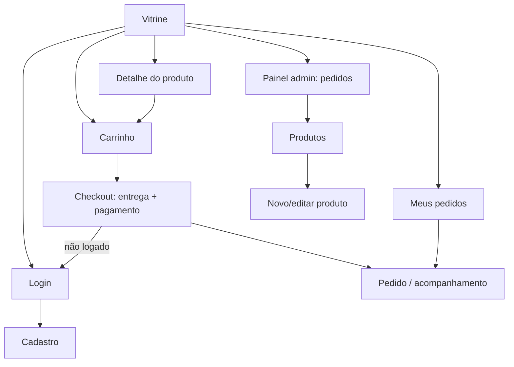

## Mensagens de erro principais
| Situação | Mensagem |
|---|---|
| Login inválido | "E-mail ou senha incorretos." |
| E-mail já cadastrado | "Já existe uma conta com este e-mail." |
| Acima do estoque | "Só temos N unidade(s) de X em estoque." |
| Pedido abaixo do mínimo | "O pedido mínimo é de R$ 15,00." |
| Cartão inválido / vencido | "Número do cartão inválido." / "Cartão vencido." |
| CEP inválido | "CEP inválido (use 00000-000)." |
| Cancelar pedido em preparo | "Este pedido já está em preparo e não pode mais ser cancelado." |
| Página inexistente / sem permissão | Páginas 404 e 403 com link para voltar à vitrine |

## Capturas
| Tela | Imagem |
|---|---|
| Vitrine | 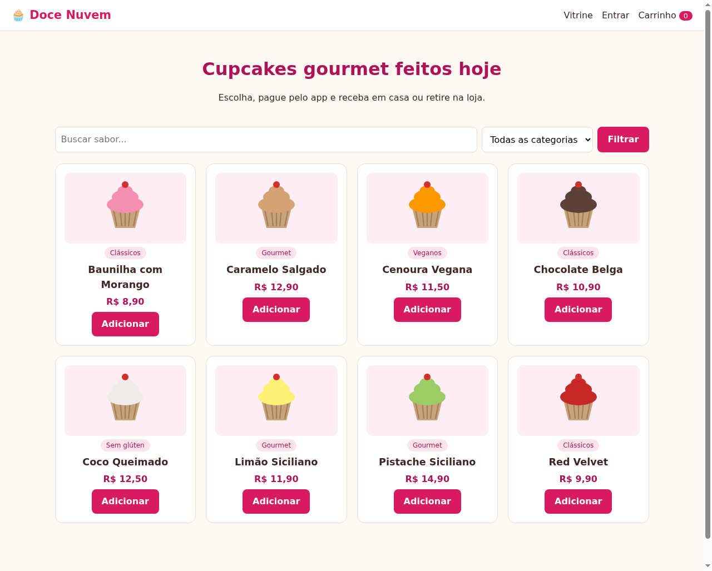 |
| Detalhe do produto | 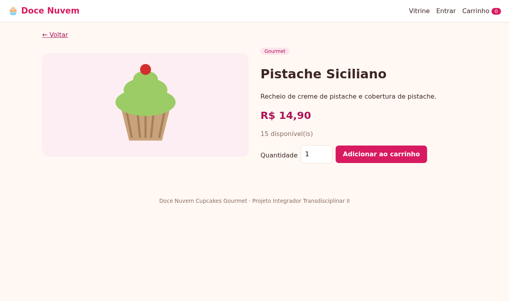 |
| Cadastro | 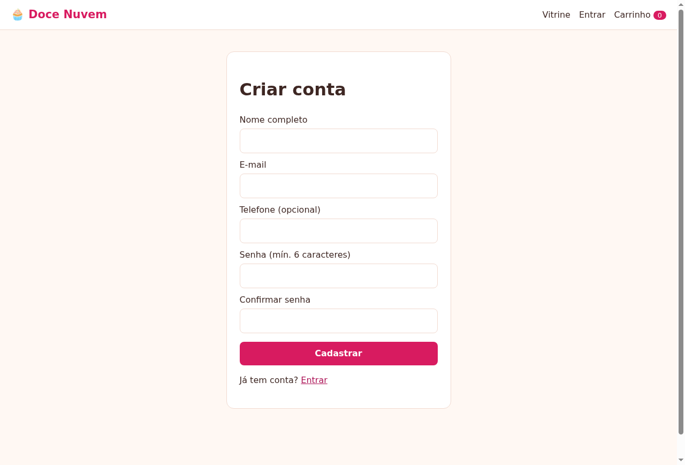 |
| Login | 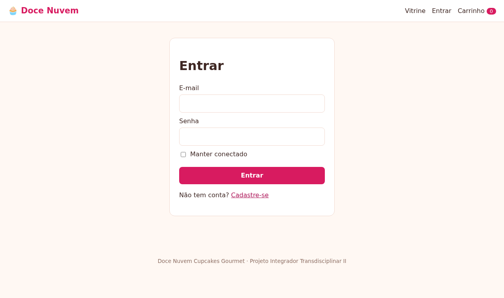 |
| Carrinho | 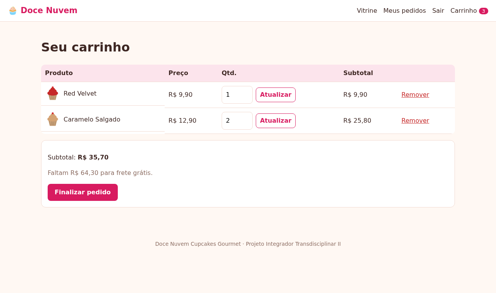 |
| Checkout | 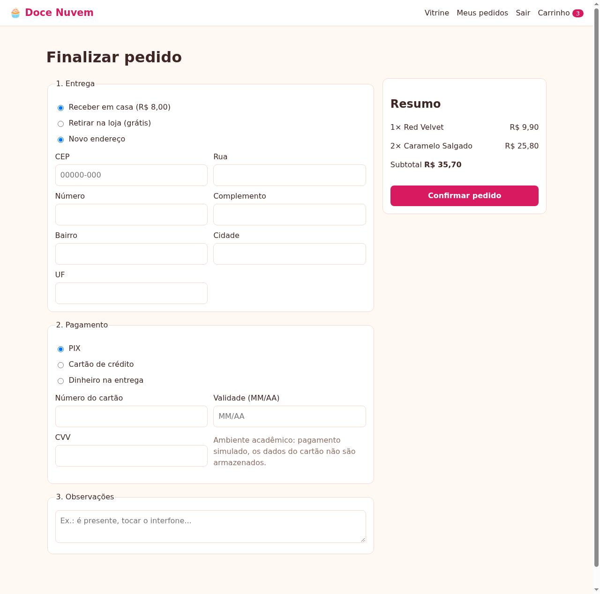 |
| Acompanhamento do pedido | 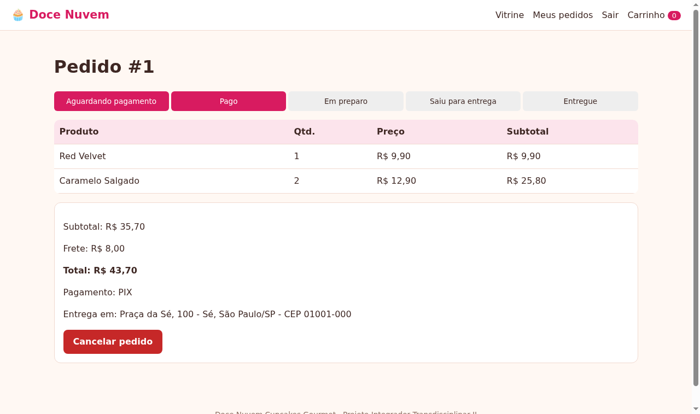 |
| Meus pedidos | 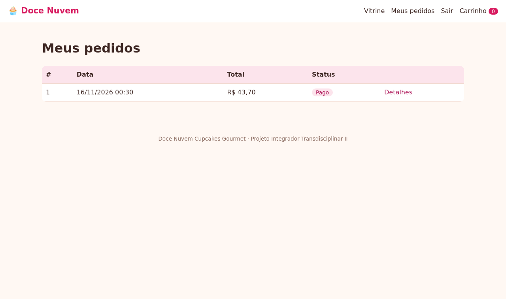 |
| Admin – pedidos | 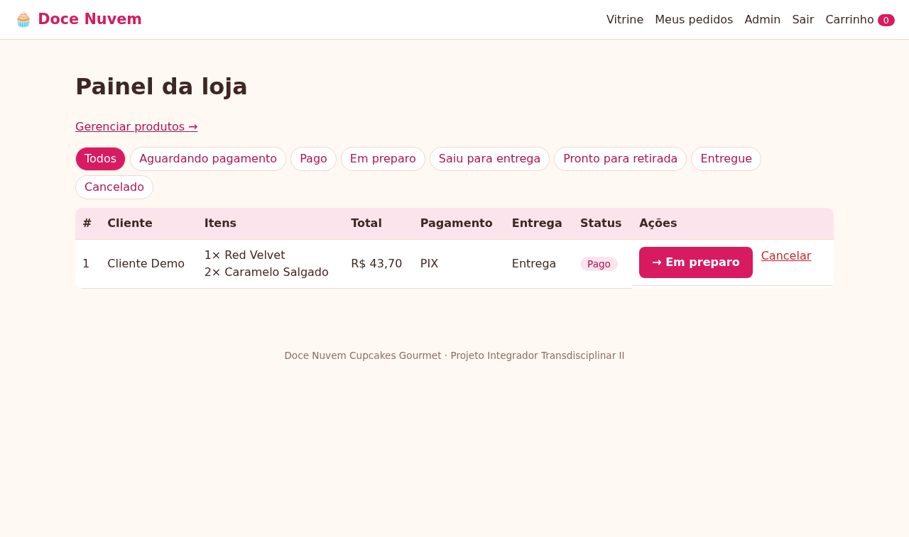 |
| Admin – produtos | 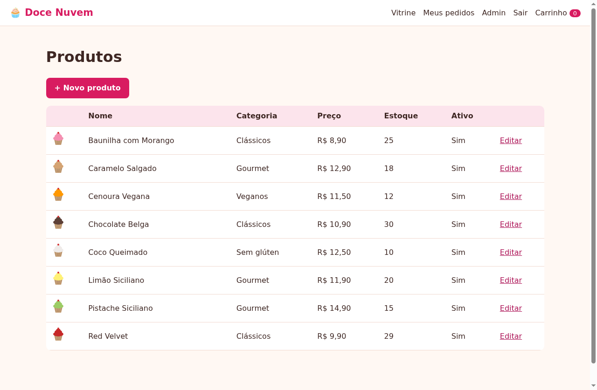 |
| Admin – editar produto | 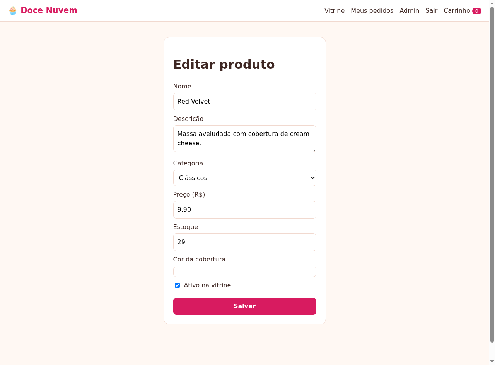 |
| Vitrine no celular | 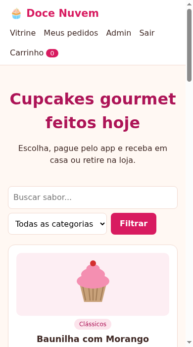 |
